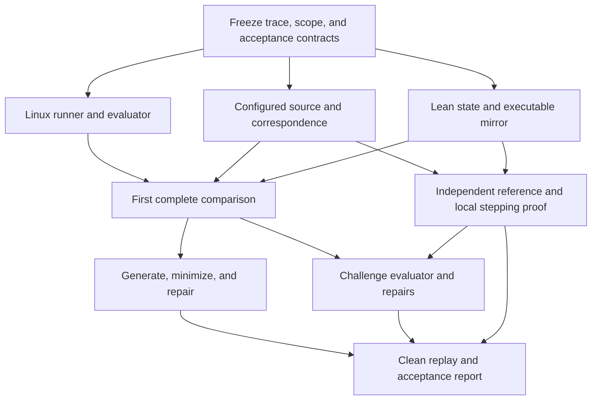

# Lean-ux prototype master plan

Status: implementation paused at the user's request, 2026-09-21. Read the
[pause handoff](pause-handoff.md) and campaign ledger before any resumption.
The original planning baseline below is dated 2026-09-20. This is the implementation plan for
[the project objectives](project-objectives.md). Writing this plan does not start
the implementation campaign. Its planned paths and commands below are proposed
deliverables unless explicitly marked as existing.

## Governing-agent start and resume protocol

Read [AGENTS.md](../AGENTS.md) first. All development occurs in worktrees, and
every update to `main` requires explicit user signoff for the concrete changes.
Automatic gates and long-cycle authorization never replace that signoff.

This file is the entry point for every cycle of the implementation goal. It
defines execution order and completion gates. The linked
[objectives](project-objectives.md) define the intended claims, the
[worktree practices](worktree-practices.md) govern workspace ownership and
cleanup, and [offline usage](offline-usage.md) describes the existing tools.
Read those supporting documents at campaign start and when relevant instructions
change. Earlier dated proposals are historical context, not competing plans.

At each goal cycle:

1. Read this plan and the durable campaign ledger at
   `.artifacts/runs/campaign.json`. On the first cycle, create that ledger and
   begin the Sprint 1 foundation, including the committed baseline and worktree
   bootstrap. The starting-point section below records planning-time status;
   subsequent progress comes from evaluated evidence in the ledger.
2. Reconcile active agents, worktrees, running jobs, incomplete attempts, and
   available disk space. Resume existing work before creating replacements.
   Reuse evidence whose source and contract dependencies remain unchanged.
3. Select the next ready obligations, delegate independent bounded tasks, and
   perform useful coordinator work concurrently. Respect the dependency graph,
   aggregate resource limits, and evaluator ownership boundary.
4. Evaluate submitted results, integrate accepted changes on a non-main branch
   in a worktree, and schedule targeted repairs. Continue automatically across
   passed gates and the informational midpoint check-in. Obtain explicit user
   signoff before any integration into `main`, in addition to the decisions below.
5. Update the ledger with evidence, unresolved obligations, and concrete next
   actions. Clean up completed worktrees through the registered lifecycle while
   preserving active work and durable results.

The goal is complete only when G1–G4 pass, the independent final replay and
recovery exercise succeed, the acceptance report is written, and finished task
worktrees/scratch state have been reconciled and cleaned up. Environment
readiness, a passing subset, or exhaustion of an attempt budget is not completion.
Report unmet obligations explicitly; do not weaken the objective to close a run.

## Outcome and starting point

Deliver an executable FD/eventfd mirror and an automatic evaluation-and-repair
workflow with computational correspondence records, adversarial acceptance
tests, and a checked local stepping theorem. The final demonstration must be
reproducible from recorded inputs and honest about its unproved source bridge.

Environment preparation is complete. The active nono session passed all eight
offline acceptance checks, including a fresh kernel build, QEMU/KCOV execution,
Lean/C/C++ builds, syzkaller builds, Lean diagnostics, and 680 dependency checks.
[The readiness record](../dependencies/sandbox-validation.json) identifies the
evidence. There is currently no semantic mirror, differential trace runner,
contributor isolation boundary, or simulation proof.

Use the existing standalone nono session and staged tools. Keep project work,
caches, task snapshots, and profiles inside this repository. Other projects are
read-only; shared profiles and global installations remain unchanged. Build and
test execution must need no network. Agent inference continues through the
existing authorized orchestration service; offline builds do not imply local
model inference.

## Operating model and human check-ins

Treat the four sprints below as one sustained campaign. Automatic gates determine
when dependent work can start; a sprint boundary is not a request for permission.
The coordinator continues through passed gates and performs routine repairs and
local design choices without asking the user to adjudicate individual failures.

There are two substantive check-ins after the user starts implementation:

| Check-in | Evidence presented | Default action |
| --- | --- | --- |
| First end-to-end result, at the end of Sprint 1 | Hand-written comparisons, the first correspondence records, and evaluator boundary results | Inform the user and continue automatically within scope |
| Prototype acceptance, after Sprint 4 | Independent replay, repair history, adversarial rejection results, proofs, and remaining obligations | Finish this prototype and recommend the next scope |

Starting the campaign acknowledges the scope and initial operating budgets;
there is no additional kickoff approval ritual. Brief progress updates during
work are informational. Internal task records and recovery checkpoints require
no human involvement.

Always obtain explicit user signoff before merging concrete changes into `main`.
Other decisions are needed when a necessary change would expand the modeled scope,
weaken observations or acceptance criteria, add trusted assumptions, require
unstaged dependencies/network or global changes, exceed authorized resource
limits, or resolve a genuinely blocked critical path. Continue independent work
while a decision is pending. A repair that preserves the frozen contract needs
no approval. A corrected evaluator implementation goes through a separately
evaluated change and full replay; a change to what it promises needs an explicit
decision. No silent exclusions are allowed to restore passing results.

## Workstreams and dependencies

Use one coordinator and up to three workers, respecting the current four-agent
limit. Delegate bounded tasks with an explicit output, file ownership, input
snapshot, contract version, and acceptance command. Integration and acceptance
are serialized by the coordinator.

| Workstream | Initial responsibility | Later responsibility |
| --- | --- | --- |
| Source and correspondence | Configured source, branch/state inventory, external helper contracts | Structural checking and independent proof-reference encoding |
| Experiment and evaluator | Trace contract, guest runner, comparison, candidate confinement | Generator, minimizer, acceptance and recovery machinery |
| Lean mirror | State representation and executable helpers after contract freeze | Repairs, local stepping proof, ownership invariant |

After the first comparison works, rotate a worker into adversarial testing. The
critic supplies executable tests or concrete failed obligations. The coordinator
does not accept either a builder's success claim or a critic's prose as evidence.
The source-reference author and mirror author should work independently on their
respective implementations after agreeing on the state relation and obligation.

Workers use task Git worktrees under `.worktrees/`, following the
[worktree and cleanup policy](worktree-practices.md). Shared staged inputs stay
in one place; each task gets private writable caches and outputs. They do not
concurrently edit shared contracts, accepted corpora, source snapshots, or kernel
outputs. The coordinator owns integration and automatic teardown. Use small
content-hashed source snapshots and patches if Git metadata operations are
unavailable. A role assignment does not change filesystem permissions.

## Sprint 1 — Establish the complete experiment

Begin with a short foundation stage owned by the coordinator. Freeze versioned
schemas for scope, traces, observations, testability, correspondence, candidate
submissions, and evaluator results. Select the initial proof fragment and record
the intended theorem contract, including the definitions of its admitted domain,
state relations, effect comparison, reference transitions, and permitted
abstractions. Freeze those definitions and their noncandidate dependency identities;
only the declared implementation side is open to candidate repair. Establish the
task ledger and unique run layout.
Create the small committed project baseline and implement shared-input/private-
output launcher support plus the worktree lifecycle. Pass the two-worktree
create/run/recovery/cleanup exercise before sustained agent fan-out. The workers
can then develop the runner, source inventory, and mirror in parallel.

The trace contract must distinguish literal descriptor numbers from references
to earlier results, define failed-producer handling, preserve stale numeric
references and reuse, fix the inherited FD layout and resource limits, and
prevent traces from targeting transport/coverage descriptors. Specify x86-64
argument widths, error representation, and I/O bytes. Compare actual descriptor
numbers literally. Account for the 32-bit initial eventfd value and 64-bit counter.

Build the C runner around the intended raw syscalls, without automatic retries
that conceal errors. Execute traces in fresh guest processes with a defined
reset procedure; use fresh guests when necessary to validate reset assumptions.
Record return values, output bytes, and errno on failure only. Separate semantic
disagreement from invalid input, unsupported behavior, resource/environment
failure, timeout, guest crash, missing coverage, and malformed output.

Capture the relevant preprocessed translation units using the actual configured
build commands, generated headers, compiler and wrapper identities. Preserve
original-source mappings, active configuration choices, and hashes of source
inputs and modifications. Start with the FD table, shared file, eventfd context,
and the helpers in the earlier [slice proposal](2026-09-20-prototype-proposal.md).
Resolve wrappers and indirect dispatch explicitly. No general C frontend or
whole-kernel CFG extractor is required for this prototype; selected fragments
receive an auditable inventory, with automation for reference and hash checks.

Implement corresponding Lean state and helpers with explicit intermediate
stages. Each helper's record names its entry/exit points, retained state, branch
conditions, updates, error paths, and external helper contracts. Labels must
refer to executable definitions; self-reported labels alone are not structural
evidence. Classify source branches as represented, absent from this build,
excluded by the domain, abstracted, or unresolved.

Prepare at least 20 hand-written traces covering ordinary/semaphore reads,
aliasing, independent objects, close order, reuse, `dup3` replacement, invalid
and equal descriptors, descriptor/status flags, lengths 0/7/8/9/16, saturation,
and deliberate descriptor exhaustion. Probe state after errors. Repeat each
accepted trace three times from the declared initial fixture. Unexpected
allocation failure is a classified experiment failure, not a passing comparison.

In parallel, implement and probe the candidate execution boundary described
below. The existing whole-project readiness sandbox does not satisfy this gate.

**Automatic gate G1:** the 20 traces agree repeatably; every implemented helper
and supported operation has correspondence and testability records; source
identity checks detect stale inputs; candidate build/execution confinement has
passed its required probes. Report the first result to the user and continue.

## Sprint 2 — Automate discovery and targeted repair

Build a seeded typed generator, per-operation comparator, and dependency-aware
shrinker. Preserve producer dependencies, observable FD reuse, supported-domain
membership, and the original failure class during minimization. A mismatch must
not shrink into a parser error or timeout. The minimizer's result need not be
globally smallest; it must be substantially simpler and independently replayable.

Start with 1,000 distinct bounded traces, up to 64 operations each, in resumable
batches. Count completed in-domain comparisons separately from generated,
rejected, duplicate, failed, and unsupported cases. Record throughput and source
branch discovery; do not infer completeness from a passing percentage.

Add per-operation KCOV attribution and Lean branch reporting. Map selected
observed decisions to the source inventory, retaining limitations caused by
instrumentation and compilation. KCOV is not a complete call graph or a proof
of intermediate state correspondence.

Evaluate a restricted syzkaller import/generation adapter against the frozen
trace contract. Unsupported constructs must be rejected explicitly. Keep the
small generator as the reference path if adapting syzkaller would expand the
scope; record the adapter result without making full syzkaller integration a
critical dependency.

Inject an aliasing fault into a separate candidate and let the workflow find,
minimize, classify, repair, and replay it. Preserve the original fault, every
attempt, and the final explanation. Do not count this seeded fault as a naturally
discovered kernel/model disagreement. Preserve and investigate natural failures
through the same workflow when they arise.

**Automatic gate G2:** at least 1,000 distinct supported traces complete; an
injected semantic failure is minimized and repaired without human semantic
editing; the repair passes the accumulated corpus; failures have complete
reproduction bundles and no outcome is silently relabeled as agreement.

## Sprint 3 — Challenge repairs and the acceptance system

Run adversarial work concurrently with Sprint 2 once its contracts are stable.
Keep regression, exploration, independent critic, and evaluator fault-injection
cases distinguishable. Generate additional challenges after a candidate is
submitted. Withheld tests supplement fixed obligations; they are not the sole
defense against specialization.

For each required fault class below, define at least one executable mutant, an
expected diagnostic class, and an accompanying valid control candidate. All
specified mutants must be rejected. This is a bounded adversarial acceptance
suite, not a complete detector for arbitrary malicious artifacts. Proof-related
mutants run when the fixed proof checker from Sprint 4 is available; the other
checks proceed independently.

| Deliberate fault | Required reason for rejection |
| --- | --- |
| Broken aliasing or incorrect state after an error | Reproducible semantic mismatch |
| Repair specialized to known seed, FD number, or counter value | Unseen neighboring trace exposes disagreement |
| Changed comparator, normalization, scope, or trusted build file | Candidate submission violates the frozen contract |
| Unsupported case reported as agreement, empty run, omitted required tests | Missing or invalid evaluator-produced evidence |
| Stale source/configuration correspondence | Provenance or dependency mismatch |
| Added axiom, proof hole, altered theorem type, or changes to the frozen relation/domain/effect definitions | Proof dependency or contract-identity mismatch |
| Candidate writes to evaluator inputs, tools, or authoritative results | Enforced boundary denial, confirmed by unchanged protected data |
| Malformed, oversized, truncated, or contradictory output; hung process | Explicit protocol/resource failure, never semantic agreement |

Keep a deliberately over-specialized repair as an experiment distinct from an
ordinary incorrect model. Require the critic to expose it and the principled
repair to pass the same challenge family. A crash or timeout is not evidence
that a semantic mutant was detected for the intended reason.

**Automatic gate G3:** every required fault above is rejected for its intended
reason, valid controls pass, the over-specialized repair fails, and the principled
repair passes. Any boundary weakness remains an explicit failed or limited gate;
it cannot be waived by relabeling the threat model after the experiment.

## Sprint 4 — Prove a local step and demonstrate reproducible completion

Begin the proof work as soon as the source fragment and Lean state stabilize;
it need not wait for all fuzzing. Use `eventfd_ctx_do_read` as the first fragment.
Its frozen reference encoding represents the configured source's branch, output
assignment, and counter subtraction as distinct steps with fixed-width values.
Use entry, after-output-assignment, and exit correspondence points, extending
mirror helper internals if necessary to expose the corresponding computation.

Prove local stepping correspondence for arbitrary related states, including
zero/nonzero counters and ordinary/semaphore flags. State writable-memory,
aliasing, lock-held, and environmental assumptions explicitly. Provide concrete
inhabited examples covering each admitted branch; ensure the supported API
domain can establish the helper's preconditions. The source reference must not
invoke the candidate mirror to define its behavior.

Prove a second invariant: under explicit well-formedness conditions, closing one
of two distinct descriptors referring to the same object preserves access through
the other. Record helper and invariant dependencies in an obligation graph.
Changes invalidate dependent proof and test evidence, including caller-side
precondition and domain-preservation obligations.

The evaluator checks the expected propositions under their frozen definitions,
kernel-checked proof terms, and transitive axiom/declaration dependencies against
the permitted baseline. Check the protected definition identities, not just the
printed theorem types: replacing a relation with `True` or its admitted domain
with `False` is a rejected contract mutation. Reject `sorry`, new unapproved
axioms, circular assumed helper claims, and weakened statements. Any extra
computation-based proof trust must be explicitly listed
and approved; it is not accepted merely because a Lean build exits successfully.

The theorem's evidence category is **encoded-fragment simulation**. Preserve the
configured C, its source mapping, and the independently reviewed reference
encoding so that the remaining source-semantics obligation is concrete. This
prototype does not claim a checked translation of kernel C or a Linux-wide
simulation theorem.

Perform a clean replay using the frozen evaluator and accepted source, fresh
candidate build outputs, and recorded dependencies. Reuse the pinned oracle
kernel unless its inputs changed; do not rebuild unrelated tooling for every
candidate. Repeat the generated corpus, regression/critic cases, boundary and
fault-injection checks, and proofs. Force one interruption and resume it, showing
that incomplete attempts cannot become accepted results.

**Automatic gate G4:** both the local stepping theorem and alias invariant pass
the fixed proof checks; G1–G3 evidence reproduces; recovery works; no mandatory
obligation is hidden or unresolved. Produce a final report with remaining source,
configuration, environment, composition, and agent-isolation obligations. Present
the final check-in and recommend the next subsystem or proof connection using
the measured bottlenecks.

## Evaluator boundary and change control

Maintain trusted scope/observation contracts, the source reference, evaluator,
and accepted evidence separately from candidate inputs. The coordinator owns
their accepted snapshots and serializes integration. Candidate submissions carry
an allowlisted patch plus claimed results; the evaluator reconstructs results
itself. A model candidate cannot submit changes to the evaluator, toolchain,
theorem contract, or frozen reference as part of its repair.

The existing `scripts/check-nono` grants the whole project writes, and
`scripts/in-bundle` configures root-level project caches. Before evaluating
candidate code, provide attempt-local build/cache paths and prepare trusted
wrappers outside the candidate's writable area. Launch builds, Lean tactics,
and binaries under a narrower child nono profile with only necessary read access,
attempt-local writes, blocked network, and no inherited control descriptors.
Keep evaluator-private tests and authoritative results outside those grants.
Parse bounded output as untrusted data. Use local profiles, without Bubblewrap,
mount operations, or changes to `~/.config/nono/`.

Before relying on this boundary, test protected-file/tool writes, symlink escapes,
access beyond the declared read/write allowlist, network attempts, inherited-FD
access, process interference, and termination of timed-out descendants. Use
disposable decoy evaluator/tool files and hashes in project-local test directories,
including a directory outside the candidate's allowlist. Probe descriptor leakage
with harness-created test descriptors, and process interference with sacrificial
harness-owned parent/sibling processes. Never attempt writes to real staged tools
or send signals to the coordinator, other agents, or unrelated processes. Test
network socket denial without contacting an external service. Specify exact
probe operations and expected outcomes; list untested channels in the report.
These checks validate the declared fixture, not all possible sandbox attacks.
Account for nono's inherited runtime permissions, including temporary locations;
protected data must not be reachable through another allowed path. Test failures are
engineering findings, not a reason to disable the boundary. If the installed
mechanisms cannot enforce a required boundary, mark the affected gate blocked
and surface the concrete constraint while continuing safe independent work.

This protects against candidate submissions and their execution within the
validated threat model. Current collaboration agents retain broader tool access
to the project. Organizational separation and hashes stored there do not protect
against a fully hostile agent exercising that access. Full contributor isolation
requires the agent's complete tool host to run under a narrower OS boundary; the
prototype report must identify this as a remaining scaling requirement unless
it has actually been implemented and independently tested.

Evaluator fixes are separate work items. Preserve old evidence, document the
fault, add a regression that distinguishes old/new evaluator behavior, review
the unchanged contract independently, and replay affected corpora and mutants
before adopting the new evaluator identity. Changing the accepted contract or
trust assumptions is a consequential scope decision, not an ordinary fix.

## Durable progress, repair budgets, and resources

Store a coordinator-owned task ledger with task ID, objective, input hashes,
contract/evaluator versions, dependencies, owner, status, attempt count, latest
evidence, unresolved obligations, and next action. Suggested task states are
`queued`, `running`, `awaiting_evaluation`, `accepted`, `needs_repair`, and
`blocked`. A worker cannot mark itself accepted.

Each attempt receives a unique directory. Write results atomically, retain prior
attempts, and reconcile unfinished records at restart. Use immutable-by-convention
snapshots plus enforced candidate permissions; do not describe local records as
tamper-proof against the broader coordinator or shared agent tool hosts.

A failure bundle includes original input and seed, raw observations, outcome
class, first divergence, original/minimized traces, relevant coverage and source
regions, source/configuration/tool hashes, assumptions, and repair history. The
next work item targets that failure or obligation. After three unsuccessful
repairs of the same classified failure, require a new diagnosis or decomposition;
do not repeat the same attempt indefinitely. Continue other ready tasks. A
critical obligation that remains blocked after bounded investigation is reported
with alternatives and the evidence needed for a decision.

Use these initial operating limits; the coordinator may reduce load automatically
and may tune batches within these ceilings after measuring throughput:

| Resource | Initial limit |
| --- | --- |
| Agent concurrency | One coordinator plus at most three workers |
| Worktrees | Three worker checkouts plus at most one evaluation checkout; paused/quarantined trees count toward the limit |
| Heavy builds | One kernel/syzkaller build at a time; at most four build jobs across workstreams |
| Guests | One active QEMU guest, one vCPU, 256 MiB |
| Generated batch | 100 traces, at most 64 operations each; 1,000 completed distinct traces for G2 |
| Execution timeout | 120 seconds per guest batch initially; tighten or reduce batch size using measured throughput |
| Candidate build/proof attempt | 15-minute execution deadline; process memory/output limits validated by the evaluator |
| Agent investigation | 45-minute work item before recording progress and replanning; this is not a requirement to stop the campaign |
| Output and storage | 16 MiB captured output per attempt; at most 8 GiB additional worktree/cache/build/evidence data in total and a 5 GiB free-space floor |

Calibrate limits with known-good Lean builds before freezing the run's operational
budgets and starting concurrent candidate execution. Begin calibration with a
2 GiB per-process address-space cap; virtual reservations may require a different
cap even when physical memory use is small. Record the chosen cap and measured
memory use separately. State precisely which limits are enforced per process
versus across a process tree; do not claim a
group memory bound from a per-process limit. Validate process-tree cleanup before
unattended execution. If a correct build exceeds a default, retain the failure
and seek a bounded budget adjustment rather than silently removing the limit.

At disk thresholds, stop new generation and remove only disposable successful
scratch data after preserving evidence. Never remove dependency archives,
`.deps/go-mod`, accepted source/proofs, minimized failures, or unique reports to
make a campaign continue. Automated recovery records are frequent; human
checkpointing is not part of the inner loop.
Apply the registered worktree teardown after completed tasks and at restart;
preserve needed untracked work and evidence before removing a checkout. Worktree
pruning is metadata maintenance, not a replacement for deleting finished scratch
outputs. The [cleanup policy](worktree-practices.md) defines ownership checks,
retention, safe removal, and recovery behavior.

## Planned repository outputs and completion report

Keep the implementation small enough to audit. These are proposed locations,
not claims that the files already exist:

| Location | Deliverable |
| --- | --- |
| `contracts/` | Versioned scope, trace, observation, candidate, and result schemas |
| `correspondence/` | Configured-source manifests, helper/state mappings, testability and obligation records |
| `Leanux/FS/` | Executable FD/file/eventfd mirror |
| `Leanux/Reference/` | Frozen source-shaped reference fragment, independently reviewed |
| `Leanux/Proofs/` | Local stepping theorem and descriptor invariant |
| `harness/` | Linux runner, generator, comparator, minimizer, and syzkaller adapter experiment |
| `evaluator/` | Trusted acceptance runner, proof checks, fault-injection cases, local nono profiles |
| `corpus/` | Small, durable regression, adversarial, and structural cases |
| `.artifacts/runs/` | Attempt workspaces, logs, snapshots, task ledger, and bulk evidence |
| `.worktrees/` | Managed task source checkouts; no copied dependency stores |
| `reports/` | Compact tracked completion report and evidence manifest |

Provide one documented offline acceptance command, a command to replay one
failure, and a command to resume local campaign jobs and list ready agent tasks.
The existing coordinator reads the ledger and schedules agents when its session
resumes. Restarting the hosting agent service or adding a new agent orchestration
platform is outside this prototype. Design these commands during Sprint 1 and
record their actual names once implemented. The final acceptance command must
derive its verdict from independently executed checks, not previously written
success flags.

The report lists G1–G4 verdicts, exact evidence identities, completed and failed
trace counts, observed branch coverage and gaps, the mismatch-to-repair history,
mutant rejection results, proof statements and assumptions, boundary probe
results, human interventions, resource usage, and unresolved obligations. Label
seeded faults separately from natural discoveries and process discipline
separately from enforced isolation. A required failed gate means an incomplete
prototype; a research limitation outside the fixed gate is reported explicitly.

Expansion follows evidence. Identify the next operation family from the interface
inventory, establish its testability and source dependencies, and repeat the same
contract–construction–evaluation process. Adding configurations, concurrency,
external events, or stronger source semantics creates explicit new obligations.
The prototype should leave that next campaign with working infrastructure and
concrete lessons about the cost of obtaining trustworthy progress.
